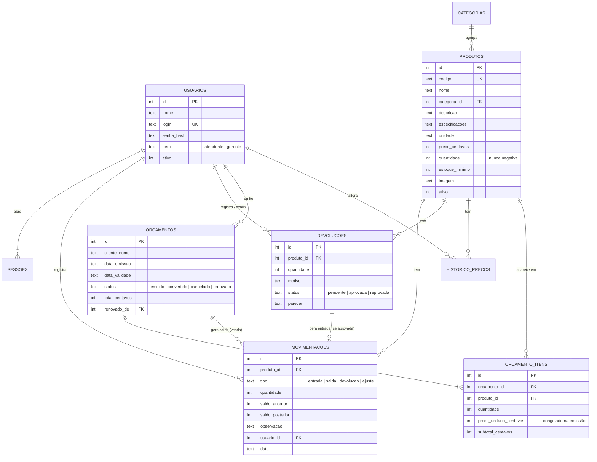

# Loja Dois Irmãos – Casa & Obra

Sistema web da **Loja Dois Irmãos – Casa & Obra** (Alvinópolis-MG), loja de materiais de construção, acabamentos,
ferramentas e componentes elétricos e hidráulicos.

O sistema tem duas partes:

- **Catálogo público:** produtos com foto, preço, descrição, especificações técnicas e disponibilidade
  (disponível/esgotado) atualizada em tempo real.
- **Painel dos funcionários:** controle de estoque em tempo real (entradas, saídas, devoluções e conferência),
  histórico de movimentações e emissão de orçamentos que bloqueia itens sem estoque.

> Projeto acadêmico da disciplina **Sistemas Web I** – UFOP / ICEA – Departamento de Computação e Sistemas.
> Docente: Fernando Bernardes de Oliveira.
> Discentes: Kaiky Linhares (24.1.8154) e Letícia Ferreira Silva (24.2.8067).

---

## O problema

A loja tinha dificuldade para:

1. **Acompanhar o estoque:** erros nos registros de vendas, devoluções e entradas impediam saber a quantidade real
   disponível, gerando divergências entre o estoque físico e o sistema e orçamentos de itens esgotados.
2. **Identificar o produto pedido pelo cliente:** materiais com nomes parecidos e especificações diferentes
   (ex.: tubo de 25 mm × 32 mm, cimento CP II × CP V) geravam erros no atendimento.

A solução é um **banco de dados com os itens do estoque** e um **catálogo com a descrição técnica de cada item**.

---

## Como executar

**Requisito:** [Node.js](https://nodejs.org/) **versão 22.13 ou mais recente** (recomendado: versão LTS atual).
O projeto **não usa pacotes externos**: o banco SQLite já vem embutido no Node.js (`node:sqlite`).

```bash
git clone https://github.com/KaikyL7/lojaDoisIrmaos.git
cd lojaDoisIrmaos
npm start
```

Depois abra no navegador:

| Página | Endereço |
|---|---|
| Catálogo (site público) | http://localhost:3000 |
| Área do funcionário | http://localhost:3000/login.html |

Na primeira execução o banco `data/loja.db` é criado com produtos e usuários de exemplo.

### Usuários de teste

| Perfil | Usuário | Senha |
|---|---|---|
| Gerente | `gerente` | `gerente123` |
| Atendente | `atendente` | `atendente123` |

> Em uso real, troque essas senhas pela tela **Funcionários**.

### Comandos

| Comando | O que faz |
|---|---|
| `npm start` | Inicia o servidor na porta 3000 (ou na variável `PORT`) |
| `npm run reset-db` | Apaga o banco para recriá-lo com os dados de exemplo (com o servidor desligado) |

---

## Funcionalidades × requisitos

### Requisitos funcionais

| Requisito | Onde está no sistema |
|---|---|
| Controle da movimentação do estoque | **Entradas e saídas**, **Devoluções** e **Conferência de estoque** |
| Consultar a quantidade disponível em tempo real | **Produtos e estoque** (atualiza sozinho a cada movimentação) |
| Estoque com nome, preço e imagem de cada produto | Cadastro de produtos (foto enviada ou ilustração), catálogo público |
| Geração e emissão de orçamentos | **Novo orçamento** e **Orçamentos** (impressão/PDF e envio por WhatsApp) |
| Autenticação e acesso de funcionários | Login com credenciais individuais e perfis **Atendente** e **Gerente** |

### Regras de negócio

| Regra | Como foi implementada |
|---|---|
| Cadastro de produtos | Nome, preço, imagem e quantidade são obrigatórios; código, unidade, descrição e especificações técnicas são opcionais. |
| Controle de entrada | Toda entrada grava produto, quantidade, data/hora e funcionário, e atualiza o saldo automaticamente. |
| Controle de saída | A saída desconta do saldo; o sistema **impede saldo negativo** (no código e por `CHECK` no banco). |
| Controle de devoluções | A devolução é registrada com produto, quantidade, data e motivo e fica **pendente**. Só volta ao estoque quando o gerente confirma que a mercadoria pode ser vendida. |
| Estoque em tempo real | Cada movimentação confirmada atualiza o saldo e avisa todas as telas abertas (Server-Sent Events). |
| Geração de orçamentos | Produtos, quantidades, preço unitário, total por item e total geral. |
| Disponibilidade no orçamento | O orçamento **não é confirmado** se algum item estiver esgotado ou com quantidade acima do estoque; o funcionário vê a lista de problemas. |
| Validade dos orçamentos | Todo orçamento tem data de emissão e validade. Depois do prazo aparece como **expirado** e só pode ser **renovado**, o que confere de novo preços e disponibilidade. |
| Alteração de preços | Só o gerente altera preços. Os itens do orçamento guardam o preço da emissão, e cada alteração fica no histórico de preços. |
| Autenticação | Login individual, senha com hash (scrypt), sessão em cookie `HttpOnly`. |
| Controle de permissões | Atendente: consulta, orçamentos, entradas, saídas e registro de devoluções. Gerente: tudo isso e mais cadastro de produtos, preços, aprovação de devoluções, conferência/ajustes e funcionários. As permissões são verificadas no servidor. |
| Conferência de estoque | O gerente informa a contagem física; cada divergência vira um **ajuste** com quantidade anterior, quantidade corrigida e justificativa obrigatória. |
| Histórico de movimentações | Toda movimentação guarda tipo, produto, quantidade, saldo anterior e posterior, data e funcionário, com filtros por produto, tipo e período. |

### Requisitos não funcionais

| Requisito | Como foi atendido |
|---|---|
| Usabilidade | Busca por código, medida ou especificação; avisos claros; alertas de reposição na tela inicial |
| Interface responsiva | Layout adaptado a celular, tablet e computador (CSS Grid/Flexbox e media queries) |
| Desempenho | Sem frameworks no front-end, consultas com índices, banco local SQLite |
| Segurança dos dados | Senhas com hash + salt, cookies `HttpOnly`/`SameSite=Strict`, consultas parametrizadas (contra SQL injection), dados escapados no HTML (contra XSS), *Content-Security-Policy*, bloqueio após 5 senhas erradas e validação das imagens enviadas |
| Disponibilidade | Servidor simples, sem dependências externas, e banco em modo WAL |
| Confiabilidade | Movimentações em **transações**: o saldo e o histórico nunca ficam diferentes; a quantidade do produto só muda por movimentação |
| Sincronização | O banco é atualizado na hora e as telas recebem o aviso em tempo real |

---

## Tecnologias

- **HTML5 e CSS3** (sem framework): páginas e todo o visual
- **JavaScript** (sem framework): interação das telas e comunicação com a API (`fetch`)
- **Node.js:** servidor HTTP e API REST (módulo nativo `node:http`)
- **SQLite:** banco de dados (módulo nativo `node:sqlite`)
- **Server-Sent Events:** atualização em tempo real

## Estrutura de pastas

```
lojaDoisIrmaos/
├── server.js               # Servidor: páginas estáticas + API
├── package.json
├── database/
│   └── schema.sql          # Modelo do banco (tabelas, chaves e restrições)
├── data/                   # Arquivo do banco (gerado automaticamente)
├── src/
│   ├── db.js               # Conexão, transações e dados iniciais
│   ├── http.js             # Rotas, leitura de JSON e validações
│   ├── autenticacao.js     # Sessões e permissões por perfil
│   ├── seguranca.js        # Hash de senha e limite de tentativas
│   ├── estoque.js          # Regra central de movimentação do estoque
│   ├── imagens.js          # Upload e validação das fotos
│   ├── tempo-real.js       # Avisos em tempo real (SSE)
│   └── rotas/              # auth, produtos, estoque, orcamentos, usuarios
└── public/                 # Front-end
    ├── index.html          # Catálogo público
    ├── login.html
    ├── css/                # estilo.css (geral/site) e painel.css
    ├── js/                 # Um arquivo por página + comum.js e painel.js
    ├── img/                # Logo e ilustrações dos produtos
    ├── uploads/            # Fotos enviadas pelo painel
    └── painel/             # Páginas internas (estoque, orçamentos…)
```

Para trocar endereço, telefone ou horários da loja, edite o objeto `LOJA` no início de `public/js/comum.js`.

## Modelo do banco de dados



O script completo está em [`database/schema.sql`](database/schema.sql). Os valores em dinheiro são guardados em
**centavos** (inteiros) para evitar erros de arredondamento.

## Principais rotas da API

| Método | Rota | Acesso | Descrição |
|---|---|---|---|
| POST | `/api/auth/login` | público | Login do funcionário |
| GET | `/api/catalogo` | público | Produtos do catálogo (sem quantidade exata) |
| GET | `/api/produtos` | funcionário | Estoque com quantidades em tempo real |
| POST/PUT | `/api/produtos` | gerente | Cadastro e edição (preço gera histórico) |
| POST | `/api/movimentacoes/entrada` · `/saida` | funcionário | Movimenta o estoque |
| GET | `/api/movimentacoes` | funcionário | Histórico com filtros |
| POST | `/api/devolucoes` | funcionário | Registra devolução (pendente) |
| POST | `/api/devolucoes/:id/avaliar` | gerente | Aprova (volta ao estoque) ou reprova |
| POST | `/api/conferencia` | gerente | Conferência físico × sistema |
| POST | `/api/orcamentos` | funcionário | Emite orçamento (verifica estoque) |
| POST | `/api/orcamentos/:id/renovar` · `/converter` · `/cancelar` | funcionário | Renovação, venda e cancelamento |
| GET | `/api/eventos` | todos | Canal de tempo real (SSE) |
